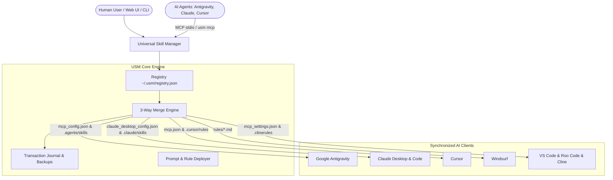

# Universal Skill Manager (USM)

<p align="center">
  
</p>

<p align="center">
  <strong>The central hub for MCP servers, AI agent skills, and prompt rules across all your AI coding assistants.</strong>
</p>

<p align="center">
  <a href="LICENSE"></a>
  
  
  
  
</p>

---

## 🚀 Why Universal Skill Manager?

Modern AI software engineering tools use disparate configuration files, formats, and conventions:
- **Claude Desktop** uses `%APPDATA%\Claude\` or Windows MSIX container paths (`claude_desktop_config.json`).
- **Google Antigravity** uses `~/.gemini/config/mcp_config.json` with workspace or global `.agents/skills/`.
- **Cursor** uses `.cursor/mcp.json` and `.cursor/rules/*.mdc`.
- **Windsurf** uses `.windsurf/rules/*.md`.
- **Claude Code CLI** uses `~/.claude.json` and `~/.claude/skills/`.
- **VS Code (Roo Code / Cline / Native MCP)** uses individual extension paths and `.clinerules/`.

**Universal Skill Manager (USM)** unifies them all into a single, bulletproof management engine. Install once, configure once, and every AI agent on your computer shares the exact same capabilities.

---

## ✨ Key Features

1. **🛡️ 3-Way Merge & Zero-Data-Loss Safety:**
   - Unmanaged and user-configured MCP servers are **never overwritten or deleted**.
   - Automatic timestamped backup (`.bak_<timestamp>`) created before any file modification.
   - Post-write verification ensures JSON configs remain valid and unchanged keys stay bit-for-bit intact.
   - Instant 1-command rollback with `usm undo`.

2. **🤖 Autonomous Agent Native (MCP v2 Server):**
   - USM runs as a standard **Model Context Protocol Server** (`usm mcp`).
   - Exposes 7 tools (`usm_status`, `usm_list_skills`, `usm_add_mcp_server`, `usm_add_prompt_skill`, `usm_remove_skill`, `usm_sync_all`, `usm_undo`).
   - Run `usm setup-agent` and all your agents (Antigravity, Claude, Cursor) can manage their own tools autonomously when you ask them to!

3. **📝 Universal Prompt & Rule Skills:**
   - Deploy and sync Markdown instructions and guidelines across `.agents/skills`, `.claude/skills`, `.cursor/rules`, `.windsurf/rules`, and `.clinerules`.

4. **🌐 Modern Local Web Dashboard:**
   - Sleek dark-mode dashboard at `http://localhost:8765` (`usm ui` or `start_usm.bat`).
   - Manage servers, view diffs, run health checks, and install templates with one click.

5. **⚡ Headless Scripting & CI:**
   - All core commands support `--json` output for automated workflows and terminal agents.

6. **📦 Cross-Machine Portability:**
   - Export and import your entire toolset with `.usmpack` packages (`usm export` / `usm import`).

7. **🔒 Safe, Deterministic, & Extensible:**
   - Built with strict type annotations, 33 automated tests, and multi-client configuration adapters.

---

## 🏛️ Architecture Overview



---

## 📋 Supported Clients Matrix

| Client | MCP Server Config | Prompt / Rule Skills | Strategy |
| :--- | :--- | :--- | :--- |
| **Google Antigravity** | `~/.gemini/config/mcp_config.json` | `~/.gemini/config/skills/`, `.agents/skills/` | Native JSON + Markdown Skills |
| **Claude Desktop** | `%APPDATA%\Claude\` or MSIX LocalCache | `.claude/skills/` | Multi-strategy profile + MSIX detector |
| **Claude Code CLI** | `~/.claude.json` | `~/.claude/skills/` | Profile-driven JSON |
| **Cursor** | `.cursor/mcp.json` | `.cursor/rules/*.mdc` | Project & Global MDC rules |
| **Windsurf** | Native MCP | `.windsurf/rules/*.md` | Markdown rules |
| **Roo Code** | `%APPDATA%\Code\...\mcp_settings.json` | `.clinerules/*.md` | VS Code global storage profile |
| **Cline** | Global Storage MCP | `.clinerules/*.md` | VS Code global storage profile |
| **VS Code Native** | `%APPDATA%\Code\User\mcp.json` | — | Native VS Code MCP format |
| **OpenAI Codex / ChatGPT** | `~/.codex/config.toml` | `~/.codex/skills/`, `.codex/skills/` | Native TOML + VS Code ChatGPT extension (`openai.chatgpt`) |

---

## 📦 Installation & Quick Start

### 1. One-Click Setup

#### Windows:
Double-click `install.bat` or run:
```cmd
install.bat
```

#### macOS / Linux:
```bash
chmod +x install.sh
./install.sh
```

#### Or Manual Setup:
```bash
# 1. Clone repository
git clone https://github.com/<your-username>/universal-skill-manager.git
cd universal-skill-manager

# 2. Create virtual environment
python -m venv .venv

# 3. Activate
# On Windows:
.\.venv\Scripts\activate
# On Linux/macOS:
source .venv/bin/activate

# 4. Install in editable mode
pip install -e .
```

---

## 💻 What Happens on Your System?

When USM runs on a clean machine:
1. **Isolated USM Home (`~/.usm/`)**:
   - `registry.json`: Tracks managed MCP servers and prompt skills.
   - `settings.json`: Stores user preferences (language, auto-backup, auto-sync).
   - `journal.json`: Audit log of all transactions and changes.
   - `backups/`: Timestamped rollback snapshots taken before any write.
2. **AI Client Configurations**:
   - Only targeted clients are touched.
   - Pre-existing manual tools configured by you are **100% preserved**.

---

## 🛠️ CLI Usage Examples

### Client Status & Health Check
```bash
# Visual Rich table
usm status

# Programmatic JSON for scripts/agents
usm status --json
```

### Add MCP Servers
```bash
# From built-in templates (github, filesystem, fetch, sqlite, memory)
usm add github --template github

# Custom command
usm add my-fetch --cmd uvx --args "mcp-server-fetch" --targets all

# Preview changes safely without touching files
usm add sqlite --cmd uvx --args "mcp-server-sqlite --db-path data.db" --dry-run
```

### Add Prompt & Rule Skills
```bash
# Add a Markdown prompt rule across all agents
usm add code-reviewer --kind prompt --content "# Code Review Guidelines\nEnforce strict typing and unit tests."

# From a markdown file
usm add coding-standards --kind prompt --file rules/standards.md --targets antigravity,cursor
```

### Sync All Clients
```bash
usm sync
```

### Instant Undo / Rollback
```bash
# Rollback latest transaction
usm undo
```

### Launch Local Web Dashboard
```bash
usm ui --port 8765
# Or on Windows simply double-click start_usm.bat
```

### Automatic Agent Enablement
```bash
# Configures USM MCP server and Agent Skill across all installed AI clients
usm setup-agent
```

---

## 🤖 Using USM with AI Agents

Once you run `usm setup-agent`, USM is registered inside your AI agents. You can simply tell any agent:
- *"Add the GitHub MCP server to all my agents using USM"*
- *"Install this coding guideline as a skill across Antigravity and Cursor using USM"*

The agent will autonomously invoke the USM MCP tools:
```json
{
  "name": "usm_add_mcp_server",
  "arguments": {
    "id": "github",
    "command": "npx",
    "args": ["-y", "@modelcontextprotocol/server-github"]
  }
}
```

---

## 🧪 Running Automated Tests

```bash
# Run complete test suite (33 tests)
pytest -v
```

---

## 🤝 Contributing

Contributions are welcome! Please read [CONTRIBUTING.md](CONTRIBUTING.md) for details on code style, safety invariants, and the pull request process.

---

## 📄 License & Disclaimer

Distributed under the MIT License. See [LICENSE](LICENSE) for the full license terms.

### ⚠️ Disclaimer
- **AS-IS Software:** This software is provided "as is", without warranty of any kind. Use at your own risk.
- **AI & Autonomous Agents:** The authors and contributors assume no liability for autonomous actions, file edits, or command executions performed by AI language models or MCP agents leveraging this tool.
- **Configuration Management:** Although USM features automated timestamped backups and 3-way merge protection, users remain solely responsible for the integrity of their local development environments, personal configs, and API credentials.
